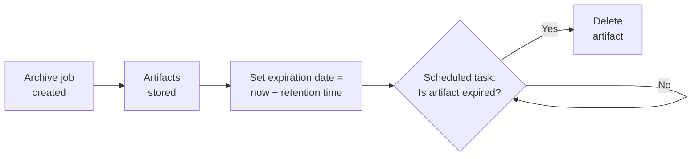
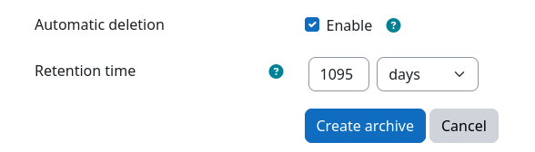

# Automatic Deletion of Archive Files

Created archives contain personal data that often must not be kept longer than a defined retention period. To comply 
with legal constraints and data protection regulations (e.g., GDPR), archives can be deleted automatically after a
configurable retention time has passed. Automatic deletion is configured individually for each archive job and equally
applies to all artifacts that were created by the respective job.

## How it works

Whenever an archive job artifact is created, the desired retention time is added to the current time. The resulting date
is then stored as the expiration date for every artifact of the job. Artifact files without automatic deletion never
expire and are kept until they are deleted manually.

Artifacts with enabled automatic deletion are processed by the scheduled _Delete expired artifacts_
({{ source_file ('classes/task/delete_expired_artifacts.php') }}) task that periodically checks them for expiry and
deletes them from the respective [archiving store](../archivingstore/index.md) once their retention period elapsed.

Only the archived files themselves, including their associated [TSP data](archive-signing.md), are deleted. The archive
job, its metadata, and its [logs](logs.md) are kept and remain visible on the [course archiving overview](overview.md)
page but can optionally be deleted manually at a later point in time.

## Enabling automatic deletion

Automatic deletion can be enabled during [archive creation](archive-creation.md) by checking the
{{ mform_element('Automatic deletion', 'checkbox') }} option in the {{ mform_element('Advanced settings', 'section') }}
section. Once checked, the {{ mform_element ('Retention time', 'text') }} option appears, which controls how long the
archive is kept before it is deleted.

!!! tip "Enforcing a retention policy"
    Moodle administrators can define default values for both options at {{ moodle_nav_path ('Site administration',
    'Plugins', 'Local plugins', 'Archiving', 'Common settings') }}.  Both settings can moreover be locked by an
    administrator. This prevents users from disabling automatic deletion or changing the retention time during archive
    creation and therefore allows the enforcement of an organization-wide retention policy. See
    [Job Presets](../setup/config/job-presets.md) for more details.

## Checking the expiration date

The expiration date of each artifact is displayed on the [artifact download page](download.md) of the respective archive
job. It shows the remaining time until deletion, whether the artifact is scheduled for deletion, or whether it has
already been deleted.

## Controlling the deletion schedule

Since expired artifacts are deleted by a regular Moodle scheduled task, the point in time at which they are removed can
be controlled by adjusting the execution schedule of this task. To do so, a Moodle administrator has to follow these
steps:

1. Navigate to {{ moodle_nav_path('Site administration', 'Server', 'Tasks', 'Scheduled tasks') }}
2. Locate the _Delete expired artifacts_ (`\local_archiving\task\delete_expired_artifacts`) task and click the edit icon
next to it
3. Adjust the schedule to your needs
4. Save the changes

The default schedule of this task is:

| Minute | Hour | Day | Month | Day of week |
|--------|------|-----|-------|-------------|
| `0`    | `*`  | `*` | `*`   | `*`         |

Artifacts are deleted during the first task execution after their expiration date has passed. Restricting the schedule
therefore allows you to delay the deletion of expired artifacts to a specific date, e.g., only once per year.

!!! danger "Do not disable this task"
    If the task is disabled, no artifacts will be deleted automatically, regardless of their expiration date.

### Example: Deletion on a fixed reference date

Some institutions are legally obliged to keep exam archives for a minimum number of years and to delete them on a fixed
reference date afterward, e.g., at the end of an academic year. In this example, archives must be kept for **at least 2 
years** and must then be deleted on **January 1st** of the year following the end of the retention period.

This can be achieved by combining the retention time with a custom deletion schedule:

1. Navigate to {{ moodle_nav_path('Site administration', 'Plugins', 'Local plugins', 'Archiving', 'Common settings') }}
    1. Check `job_preset_archive_autodelete` and lock it
    2. Set `job_preset_archive_retention_time` to 2 years (730 days) and lock it
    3. Save all settings
2. Navigate to {{ moodle_nav_path('Site administration', 'Server', 'Tasks', 'Scheduled tasks') }}
    1. Edit the task `\local_archiving\task\delete_expired_artifacts`
    2. Set its schedule to:

        | Minute | Hour | Day | Month | Day of week |
        |--------|------|-----|-------|-------------|
        | `0`    | `0`  | `1` | `1`   | `*`         |

    3. Save the changes

Now, every archive expires 2 years after its creation. However, the expired artifacts are only deleted once per year,
on January 1st. Archives created in the same year are therefore deleted together:

| Archive created  | Expiration date  | Deleted on       |
|------------------|------------------|------------------|
| 2024-01-15 13:37 | 2026-01-14 13:37 | 2027-01-01 00:00 |
| 2024-07-01 10:42 | 2026-07-01 10:42 | 2027-01-01 00:00 |
| 2024-12-23 06:09 | 2026-12-23 06:09 | 2027-01-01 00:00 |
| 2025-01-10 16:32 | 2027-01-10 16:32 | 2028-01-01 00:00 |

!!! warning "Pitfall: Retention time starts with archive creation"
    As the retention time starts with the creation of the archive, an exam that took place in December but was archived
    in January of the following year will be deleted one year later than intended (see the last row of the table above).
    Make sure to archive your activities in the same year they took place.

