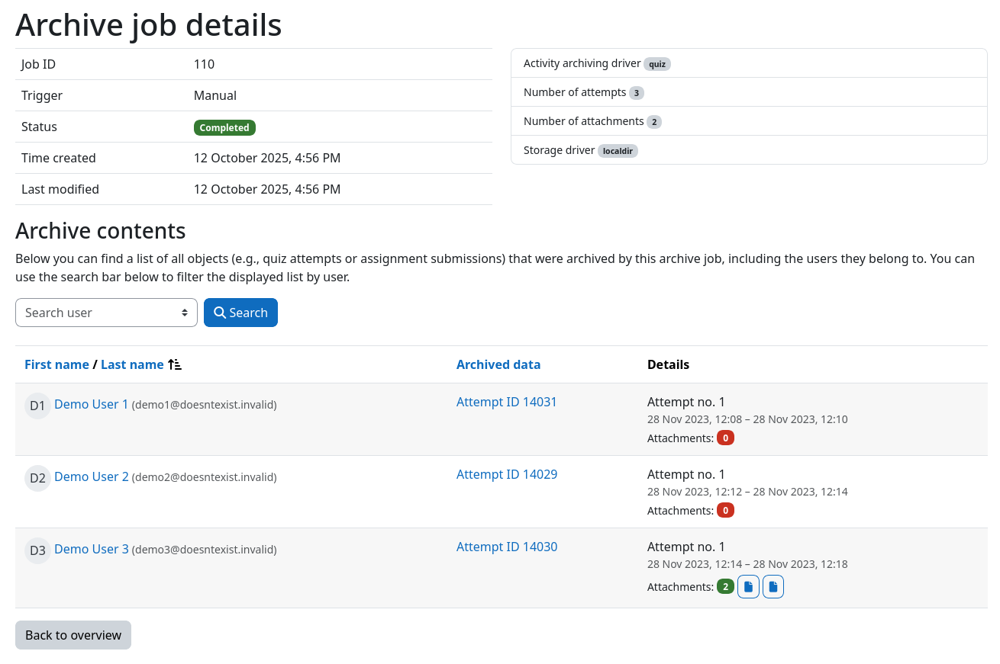

# Archive Job Details

Each archive job has a details page that provides general information about the job and lists all objects (e.g., quiz
attempts or assignment submissions) that were archived by it, including the users they belong to.

The job details page can be accessed from the [course archiving overview](overview.md) by clicking on the _Details_
button of the desired archive job. Alternatively, you can click on the number of archived objects that is displayed
next to the activity name inside the job overview table.

## Job information and metadata

The top section of the page displays general information about the archive job, such as its ID, the trigger that
created it, its current status, and the time it was created and last modified. Next to it, additional job metadata is
listed (e.g., the used activity archiving and storage drivers, or the number of archived attempts and attachments).

## Archive contents

The table at the bottom of the page lists all objects that were archived by this archive job. For each object, the 
following information is displayed:

- **User**: The user the archived object belongs to, including additional identity fields (e.g., email address) if
  configured by your Moodle administrator.
- **Archived data**: A label that identifies the archived object (e.g., _Attempt ID 1234_) and links directly to it 
  (e.g., the quiz attempt review page).
- **Details**: Additional information about the archived object, provided by the respective activity archiving driver.
  For quizzes, this includes the attempt number, the attempt date, and links to attached files. For assignments, the
  submission attempt number and date are shown.

!!! tip "Searching for specific users"
    You can use the user search bar above the table to only display objects that belong to a specific user.
